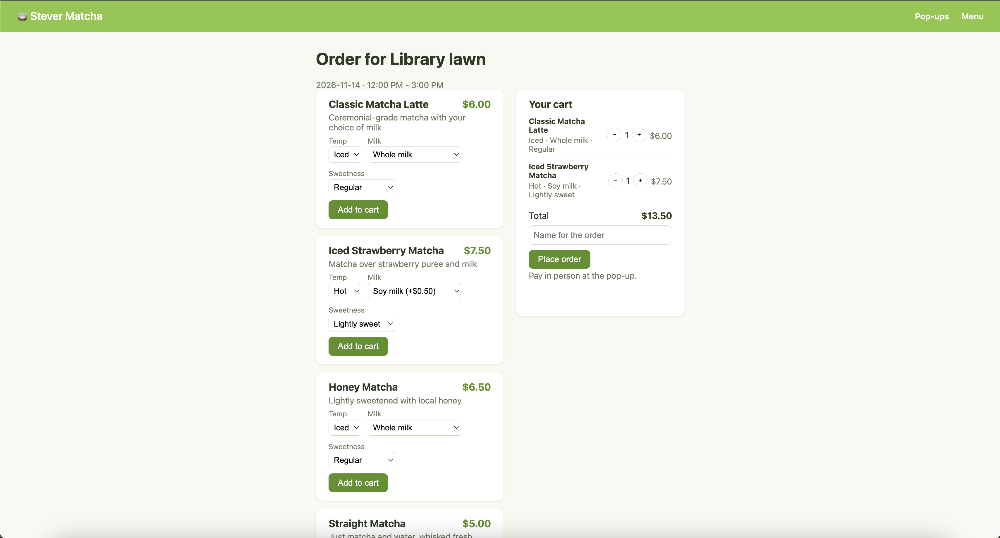
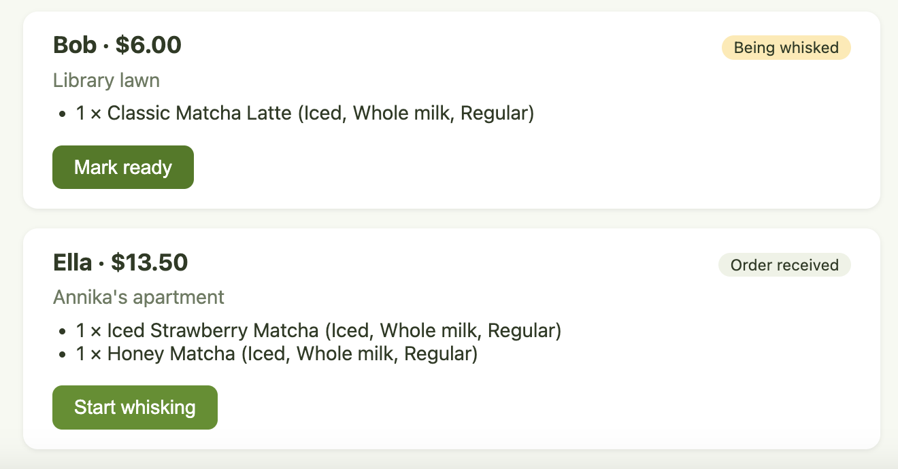

# Stever Matcha Ordering App

A full-stack pre-ordering web app for **Stever Matcha**, a small matcha business my roommate Annika and I run at college. We sell at pop-ups hosted in people's homes and on campus, and this app replaces taking orders by hand in a crowded room.

**Live demo:** _[add link once deployed]_



## The problem

At our pop-ups, orders were taken in person: a line of people, custom requests ("oat milk, less sweet"), and names shouted across the room. It was slow, easy to get wrong, and hard to track who was still waiting.

## What the app does

**For customers**
- Browse upcoming pop-ups and pre-order from their phone
- Customize each drink (temperature, milk, sweetness) with the **price updating live** as they choose (e.g. oat milk +$0.75)
- Live cart with quantity controls and a running total, updated with no page reload
- A personal **order status page** that updates on its own: *Order received → Being whisked → Ready for pickup!*

**For the Stever Matcha team**
- Password-protected **admin queue** showing open orders, which refreshes automatically as new ones arrive
- One-tap buttons to move an order through *whisking → ready → picked up*, which instantly updates the customer's status page
- Email notification for every new order

Payment happens in person at the pop-up, so there is no payment processing.



## How it works

```
Customer browser ──POST /api/orders──▶ Flask ──▶ SQLite
       ▲                                  │
       │ polls /api/orders/<code>         ├──▶ email notification (background thread)
       │ every 3 seconds                  │
Admin browser ──polls /admin/api/orders───┘
       └─ POST /admin/api/orders/<id>/status
```

- **Backend:** Python + Flask, with JSON endpoints for the cart and status updates
- **Database:** SQLite with four tables: `popups`, `menu_items`, `orders`, `order_items`
- **Frontend:** Jinja templates plus vanilla JavaScript (`fetch`, DOM updates) and hand-written CSS
- **Live updates:** the customer and admin pages poll the server every 3 seconds

### Design decisions worth noting

- **Prices are calculated on the server.** The browser sends only drink IDs and choices, never prices, so a customer can't edit the page to order a $0 latte. Every field (menu item, milk, sweetness, temperature, quantity) is validated against the database and an allow-list before an order is saved.
- **Order links are unguessable.** Each order gets a random code (`secrets.token_urlsafe`), so one customer can't view another's order by changing a number in the URL.
- **Prices are stored in cents** to avoid floating-point rounding bugs with money.
- **Each order line stores a snapshot** of the item name and price at the time of purchase, so changing the menu later doesn't alter past orders.
- **XSS protection:** customer names are untrusted input, so the admin page builds its DOM with `textContent` rather than `innerHTML`.
- **Parameterized SQL queries** throughout, to prevent SQL injection.
- **Admin routes sit behind a login** using signed session cookies. The admin password and email credentials come from environment variables, not from the code.
- **Polling instead of WebSockets.** For a pop-up with a few dozen orders, polling is simple and reliable. At larger scale I would switch to server-sent events or WebSockets.

## Run it locally

```bash
git clone https://github.com/noemidmb/stever-matcha-app.git
cd stever-matcha-app
pip install -r requirements.txt
python app.py
```

Then open <http://127.0.0.1:5001>. The database file (`stever.db`) is created with sample pop-ups and menu items on first run.

- Customer view: `/`
- Admin queue: `/admin` (default password `matcha`, **change it** for anything real)

### Configuration (environment variables)

| Variable | Purpose |
|---|---|
| `ADMIN_PASSWORD` | Password for `/admin` |
| `SECRET_KEY` | Signs the login session cookie |
| `SMTP_USER` | Gmail address that sends order notifications |
| `SMTP_PASSWORD` | Gmail [app password](https://myaccount.google.com/apppasswords) |
| `NOTIFY_EMAIL` | Inbox that receives order notifications |

If the email variables aren't set, new orders are printed to the terminal instead, so the app works without them.

## Project structure

```
app.py              Flask app: routes, database setup, validation, admin auth
templates/          Jinja HTML templates (order page, status page, admin)
static/
  order.js          Live cart, customization, order submission
  status.js         Customer status polling
  admin.js          Admin queue rendering and status buttons
  style.css         Styling
requirements.txt
```

## What I'd build next

- Admin page to add and edit pop-ups and menu items without touching the code
- Per-pop-up drink limits with a "sold out" state
- **Demand forecasting:** use past orders (day, time, location, weather) to predict how much matcha and milk to prep for each pop-up. I'm collecting real order data to make this meaningful.
- Order history and sales stats

## About

Built by [Noemi Barbagli](https://github.com/noemidmb), a Computer Science and Statistics/Machine Learning student, as a real tool for a real small business.
